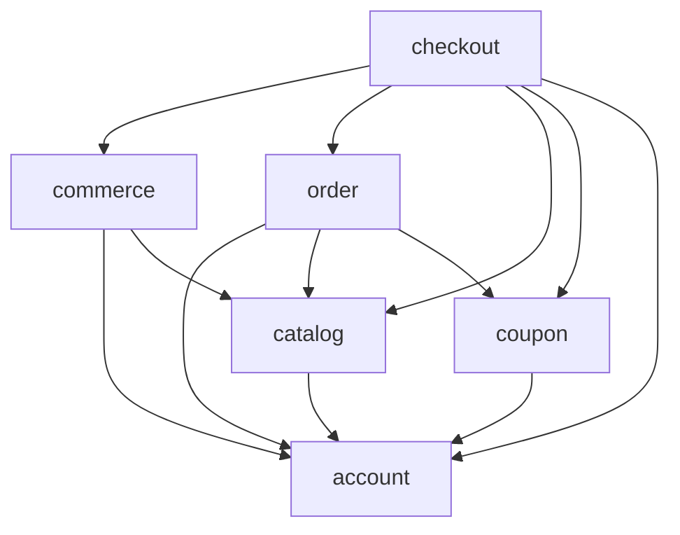

# Arquitetura

O backend é um monólito modular, com uma transação local para checkout. O frontend Angular é uma aplicação separada. Não há microsserviços, mensageria, gateway de pagamento ou segundo mecanismo de autenticação.

## Estrutura

```text
.
├── pom.xml, mvnw, Dockerfile        # Backend Java 21 / Spring Boot 3.5.11
├── src/main/java/com/guilherme/ecommerce/
│   ├── EcommerceApplication.java
│   ├── account/
│   │   ├── controller/             # Conta, perfil, senha, membros e token CSRF
│   │   ├── dto/{request,response}/
│   │   ├── domain/                 # Account, Company, Role
│   │   ├── repository/             # AccountRepository, CompanyRepository
│   │   ├── security/               # Sessão, UserDetailsService, CurrentAccount, erros
│   │   └── service/                # AccountService, AccountLockService, bootstrap
│   ├── catalog/
│   │   ├── controller/
│   │   ├── dto/{request,response}/
│   │   ├── domain/                 # Product, Category
│   │   ├── repository/
│   │   └── service/                # Catálogo e gestão de seus cadastros
│   ├── commerce/
│   │   ├── controller/             # AddressController, CartController
│   │   ├── dto/{request,response}/
│   │   ├── domain/                 # Address, CartItem e identidade composta
│   │   ├── repository/             # Inclui projeção escalar CartLine
│   │   └── service/                # AddressService, CartService
│   ├── coupon/
│   │   ├── controller/
│   │   ├── dto/{request,response}/
│   │   ├── domain/                 # Coupon e regras de consumo/desconto
│   │   ├── repository/
│   │   └── service/
│   ├── order/
│   │   ├── controller/             # Consultas, vendas, pagamento e entrega
│   │   ├── dto/{request,response}/
│   │   ├── domain/                 # Pedido, item, pagamento, entrega e estados
│   │   ├── repository/
│   │   └── service/                # OrderService, OrderOperationsService
│   ├── checkout/
│   │   ├── controller/
│   │   ├── dto/request/
│   │   ├── domain/                 # CouponRedemption e identidade composta
│   │   ├── repository/
│   │   └── service/                # Orquestração atômica da compra
│   └── shared/                     # Recursos ausentes, advice e exceções de negócio
├── src/main/resources/
│   ├── application.properties
│   ├── application-prod.properties
│   └── db/migration/V1__schema.sql  # Preservada; Flyway controla o schema
├── src/test/java/.../               # Integração H2/PostgreSQL e arquitetura
├── frontend/
│   ├── src/app/
│   │   ├── core/{auth,guards,interceptors,services}/
│   │   ├── shared/{components,models,validators}/
│   │   ├── features/{authentication,catalog,cart,checkout,orders,account,admin}/
│   │   └── layout/
│   ├── public/                     # Configuração pública, fontes/licença e imagens
│   ├── e2e/                        # Playwright contra stack real
│   ├── Dockerfile, nginx.conf
│   └── angular.json, package-lock.json
└── docker-compose.yml              # Nginx/Angular → Spring Boot → PostgreSQL
```

## Responsabilidades e dependências

`Controller → Service → JpaRepository`. Controllers adaptam HTTP e Bean Validation; services autorizam e delimitam transações; entidades encapsulam consumo de estoque, cupom e transições; repositories definem consultas e locks. Records de resposta preservam explicitamente os nomes JSON anteriores com `@JsonProperty`; nenhuma entidade ou mapa de banco é retornado pela API.

`account` contém identidade, cargos e a empresa associada aos membros. `catalog` usa essa identidade para produtos e expõe os cadastros de empresas/categorias. Isso evita uma dependência de conta em catálogo. `commerce` contém endereço/carrinho; `coupon` controla as promoções; `order` contém o histórico e as operações de pagamento/entrega; `checkout` coordena os demais sem receber chamadas deles. A associação de resgate pertence ao checkout e aponta para conta, cupom e pedido.



Dependências em `shared` foram omitidas do desenho. `LayerArchitectureTest` verifica o grafo real de referências do código e rejeita ciclos. Serviços concretos são suficientes: as interfaces Spring Data representam o contrato de persistência; `UserDetailsService` representa a integração de autenticação. Não há interfaces `*ServiceImpl` sem alternativa real de implementação.

## Persistência e compatibilidade

Hibernate usa as mesmas 12 tabelas e chaves existentes, com IDs `IDENTITY`. V1 não foi alterada e nenhuma migração adicional foi necessária. `ddl-auto=validate` impede criação/alteração automática; `open-in-view=false` exige que a montagem das respostas ocorra na transação do service.

As relações são unidirecionais e lazy: produto → empresa/categoria; conta → empresa; endereço/carrinho → conta; item/pedido → referências históricas. Pagamento e entrega são `@OneToOne` com `@MapsId`, preservando `order_id` como chave primária. Carrinho e resgate usam `@IdClass`, pois suas associações têm atributos/regras próprios. Não foram acrescentadas coleções `@OneToMany` ou `@ManyToMany` apenas para representar o caminho inverso de uma FK; os repositories consultam explicitamente essas linhas. Não há cascata de exclusão que apague históricos.

O carrinho usa `@EntityGraph(product)` e as vendas usam `@EntityGraph(order)` para evitar N+1. Nas demais respostas, referências lazy são usadas apenas para obter IDs. O checkout lê primeiro a projeção escalar `CartLine`, sem carregar o estoque antes do lock. Queries derivadas e JPQL usam parâmetros; a busca mantém semântica de substring literal, inclusive para `%`, `_` e tentativas de SQL injection.

## Transações e concorrência

Services de leitura são `@Transactional(readOnly=true)`; gravações sobrescrevem com `@Transactional`. `AccountLockService.lock` exige transação existente (`MANDATORY`), evitando locks liberados antes da operação. Endereços e carrinho não precisam depender do checkout para usar esse bloqueio.

Uma compra executa:

1. Resolve a conta da sessão e bloqueia sua linha.
2. Procura pedido prévio por conta/chave; se existir, devolve o mesmo resumo.
3. Valida endereço próprio e consulta linhas de carrinho ordenadas por produto.
4. Bloqueia cada produto nessa ordem, valida disponibilidade e consome estoque.
5. Bloqueia cupom, valida validade/limite/resgate e calcula desconto decimal.
6. Persiste pedido com snapshots, itens, pagamento PENDING, entrega PENDING e resgate.
7. Limpa carrinho e confirma uma única transação. Qualquer falha reverte tudo.

A restrição única de conta/chave complementa a serialização da conta. O bloqueio pessimista impede duas compras da última unidade; o bloqueio do cupom preserva seu limite global. Não foi acrescentado `@Version`: para essas operações, locks pessimistas mantêm a semântica existente sem exigir alteração de schema. Isso custa espera em linhas disputadas; deve ser monitorado em produção. Atualizações de produto e operações de pedido usam os mesmos locks dos respectivos recursos.

Não há I/O externo na transação. Pagamento continua manual. `PurchaseOrder` permite apenas `AWAITING_PAYMENT → PAID → SHIPPED → DELIVERED`; a confirmação também exige pagamento PENDING. Valores usam BigDecimal, escala de duas casas e HALF_UP para desconto. O limite NUMERIC(14,2) permanece no banco: totais que excedem esse limite produzem conflito e rollback.

## Autenticação e autorização

`SecurityFilterChain` mantém form login `/api/auth/login`, BCrypt custo 12 e sessão no servidor. `AccountUserDetailsService` normaliza e-mail e carrega o hash existente. CSRF permanece ativo inclusive no cadastro, login e logout. O Angular obtém o token mascarado por `/api/auth/csrf` e o envia no header indicado; a referência em memória é descartada após login/logout/troca de senha ou 403. Mutações com falha não são repetidas automaticamente.

`CurrentAccount` consulta cargo/empresa no banco em cada caso de uso. Uma role antiga na sessão não concede acesso após revogação. A autorização de empresa distingue SELLER e OWNER; a propriedade de endereço/pedido está nas consultas pelo ID da conta. Guards Angular melhoram a navegação, mas não concedem autorização de API. Não se usa `hasRole`/`@PreAuthorize` com uma role de sessão desatualizada como única proteção.

Logout invalida sessão, limpa autenticação e remove cookie JSESSIONID. A troca de senha invalida a sessão atual depois que o service confirma a transação. Cookies são HttpOnly, SameSite=Lax, somente via cookie (sem ID em URL); Secure é padrão de produção. Erros de segurança 401/403 usam ProblemDetail sem informações internas; o formato do erro de credenciais de login foi preservado.

## Frontend e publicação

Angular standalone com componentes/templates separados, Router e rotas lazy. Reactive Forms validam entradas, HttpClient/RxJS fazem as chamadas e Signals mantêm estado local. Sessão e CSRF permanecem somente em memória; localStorage guarda apenas o tema. Serviços por funcionalidade, editor Material reutilizável e feedback centralizado evitam duplicação dos fluxos administrativos.

O proxy de desenvolvimento e o Nginx mantêm mesma origem. O Nginx atende fallback de rotas Angular, impede fallback de arquivos inexistentes para HTML e encaminha `/api` sem remover o prefixo. API_URL é pública e restrita a caminho da mesma origem. A política CSP permite imagens HTTPS de produtos e estilos necessários ao Material, sem liberar scripts externos/inline. HTTPS termina no proxy de hospedagem; a configuração de TLS/certificados fica a cargo do ambiente.

## Trade-offs e limites

- Um único banco/transação mantém consistência, mas não oferece escalabilidade independente de serviços.
- JPA oferece modelos tipados e dirty checking, mas exige disciplina com flush, locks e carregamento lazy.
- Sessões locais são simples; reinício perde sessões e várias réplicas exigem armazenamento compartilhado.
- Endpoints auxiliares preservam limites fixos (100/500); as listas principais mantêm paginação existente.
- Sem gateway, frete, e-mail, recuperação de senha, cancelamento, reembolso ou expiração automática de estoque reservado por pedido.
- E2E cobre cenários representativos; não substitui auditoria de segurança, teste de carga ou verificação de cada combinação de navegador/dispositivo.
